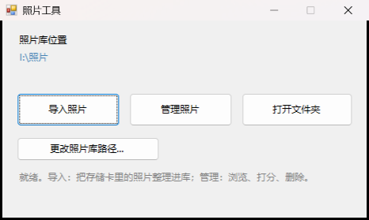
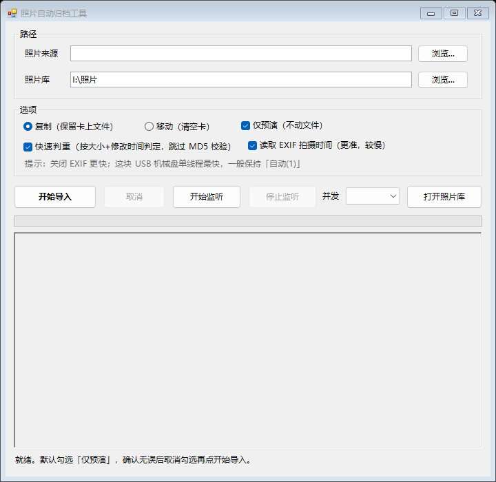
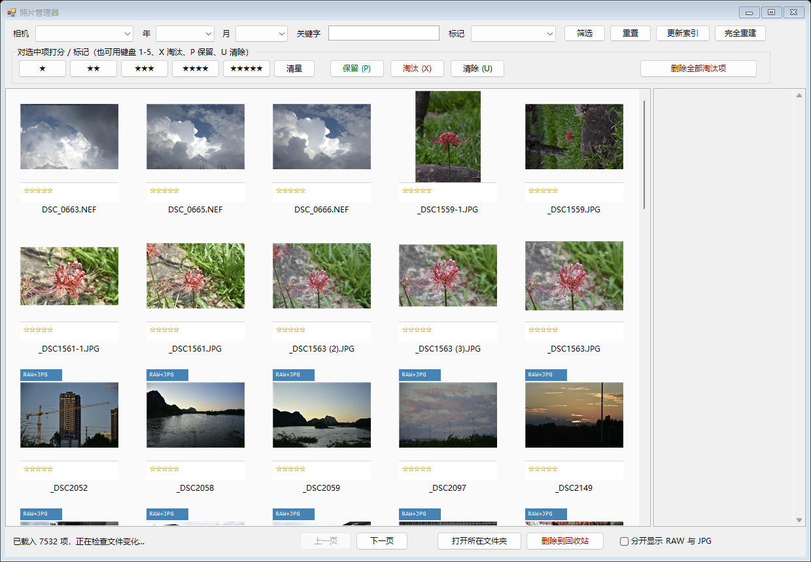

# 照片工具 · Photo Toolkit

两个配套的 Windows 照片工具，用于**相机照片的自动归档**与**本地照片库的浏览/筛选/评分**。

- 无需安装、无需数据库，纯 PowerShell + .NET，双击即用
- 自研 EXIF 解析与缩略图提取，速度远快于系统 Shell COM 方案
- 增量索引：7 千张照片库，打开后自动检查变化约 **2.6 秒**
- JPG 与 RAW 自动合并为一个条目，打分一次同时生效



---

## 功能

### 1. 导入照片（自动归档）



把存储卡（或任意文件夹）里的照片按 **相机 → 年 → 年月** 自动分拣进照片库。

| 能力 | 说明 |
|---|---|
| 自动识别相机 | EXIF 机身型号 → 卡片目录名（`100D7200`/`100NZ6_2`）→ 文件编号区间，三级回退 |
| 自动识别日期 | EXIF 拍摄时间优先，视频回退到文件修改时间 |
| 目录规则 | 照片 → `<库>\<相机>\<年>\<年-月>\`；视频 → `<库>\<相机>\视频\` |
| 重复导入 | 大小 + 修改时间一致视为同一文件，跳过；同名不同内容自动改名为 `xxx_1.JPG` |
| 安全 | 默认「预演」，确认后才真正复制；默认复制不删卡 |
| 后台线程 | 导入全程界面不卡，随时可取消 |

### 2. 管理照片（浏览 / 筛选 / 评分）



| 能力 | 说明 |
|---|---|
| 缩略图网格 | 每页 60 张，几千张也能秒开 |
| 筛选 | 相机 / 年 / 月 / 文件名关键字 / 标记状态 |
| 评分与标记 | 1–5 星、保留 / 淘汰，键盘流操作 |
| RAW+JPG 合并 | 同一次拍摄的 `.JPG` + `.NEF` 合并为一个格子（`RAW+JPG` 角标），打分同时写入两个文件 |
| 预览 | 右侧大图 + 机身、拍摄时间、大小、路径 |
| 删除 | 走回收站，可还原；支持批量与「删除全部淘汰项」 |
| 自动索引 | 启动时后台增量检查，只处理新增/修改/删除的文件 |

---

## 快速开始

### 方式 A：直接用（推荐）

1. 下载/构建出 `照片工具` 文件夹
2. 双击 `照片工具.exe`
3. 点「更改照片库路径...」选择照片库根目录（例如 `D:\照片库`）
4. 之后点「导入照片」/「管理照片」

> 首次打开管理器会自动建索引（约 2–3 分钟 / 7 千张），之后每次启动只做增量检查。

### 方式 B：从源码构建

需要 Windows 10/11 + PowerShell 5.1（系统自带，无需安装）。

```powershell
# 在仓库根目录
powershell -ExecutionPolicy Bypass -File .\build.ps1
```

产物：

```
dist\
├─ 照片工具\            可直接运行的文件夹
│  ├─ 照片工具.exe       启动器
│  ├─ config.ini
│  ├─ 使用说明.txt
│  └─ app\               实际程序（6 个 .ps1）
└─ 照片工具.zip          可直接分发的压缩包
```

### 方式 C：不编译，直接跑脚本

```powershell
# 导入（先预演，加 -Apply 才执行）
powershell -ExecutionPolicy Bypass -File .\src\app\PhotoImportGUI.ps1 -TargetRoot "D:\照片库"

# 管理
powershell -ExecutionPolicy Bypass -File .\src\app\PhotoManagerGUI.ps1 -Root "D:\照片库"
```

---

## 配置

`config.ini`（与 exe 同目录）：

```ini
; 照片库根目录（导入目标 + 浏览根目录）
photoRoot=D:\照片库
```

照片库下会自动生成：

```
_缓存\
├─ index.json     索引（约 1.6 MB / 7500 项）
├─ marks.json     评分与标记
└─ thumbs\        缩略图缓存（约 60 MB / 7500 张）
```

---

## 键盘快捷键（管理器）

| 按键 | 作用 |
|---|---|
| `1`–`5` | 打 1~5 星 |
| `0` / `U` | 清除星级与标记 |
| `X` | 标记「淘汰」 |
| `P` | 标记「保留」 |
| `←` / `→` | 上一张 / 下一张（自动翻页） |
| `PageUp` / `PageDown` | 翻页 |
| 双击 | 用默认程序打开原图 |

选片流程：`筛选「未评分」→ 逐张 1-5 打分，废片按 X → 筛选「淘汰」→ 删除到回收站 → 筛选「≥4 星」得到精选`。

---

## 技术要点

### EXIF 解析不用 Shell COM

系统 `Shell.Application` 读照片属性每文件约 **20–220 ms**，而且 COM 非线程安全、无法并行。

本项目直接解析 JPEG 的 APP1 / NEF 的 TIFF IFD，C# 实现，可并行：

| 方式 | 每文件 | 2000 张 |
|---|---:|---:|
| Shell COM 串行 | 27.9 ms（冷读 220 ms） | 56 秒 ~ 7 分钟 |
| 自研解析 1 线程 | 8.4 ms | 17 秒 |
| 自研解析 4–8 线程 | **0.2 ms** | **1 秒** |

### 缩略图提取内嵌 EXIF 缩略图

JPEG 文件头里自带 160×120 的 EXIF 缩略图。直接读出这 64 KB 即可，无需解码整张图：

| 方式 | 每张耗时 |
|---|---:|
| WIC 全图解码 | 444 ms |
| **提取内嵌缩略图** | **12 ms** |

NEF 优先使用同名 JPG 的缩略图（同一次拍摄，画面一致），否则解析 NEF 的 SubIFD 取内嵌预览。

### 增量索引

按「相对路径 + 文件大小 + 修改时间」三元组判断变化，未变化直接复用旧记录：

| 场景 | 耗时 |
|---|---:|
| 全量重建（7500 项） | 153 秒 |
| 无变化增量检查 | **2.6 秒** |
| 新增 1 张 | 2.7 秒 |

### 并发策略

实测在**单块 USB 机械硬盘**上，单线程顺序复制最快（82.9 MB/s，达到裸盘写速的 98%），
多线程反而因磁头寻道竞争变慢（4 线程 65.7 MB/s）。因此默认「自动(1)」，
仅在源和目标位于不同物理盘（且为 SSD）时才有必要调高。

---

## 目录结构

```
photo-toolkit\
├─ build.ps1                  构建脚本
├─ config.example.ini         配置样例
├─ src\
│  ├─ app\
│  │  ├─ PhotoImportGUI.ps1     导入界面
│  │  ├─ PhotoCore.ps1          导入核心逻辑
│  │  ├─ PhotoWorker.ps1        导入后台线程（并发复制）
│  │  ├─ PhotoManagerGUI.ps1    管理界面
│  │  ├─ PhotoIndexWorker.ps1   索引构建（增量）
│  │  └─ PhotoLib.ps1           EXIF 解析 / 缩略图提取（C#）
│  └─ launcher\
│     └─ Launcher.cs            启动器源码
└─ docs\
   ├─ 使用说明.txt
   ├─ 导入工具说明.md
   ├─ 照片管理器说明.md
   └─ images\                  截图
```

---

## 环境要求

- Windows 10 / 11（64 位）
- Windows PowerShell 5.1（系统自带）
- .NET Framework 4.x（Win10 起自带）

> ⚠️ 修改 `.ps1` 后**必须保存为 UTF-8 带 BOM**。
> PowerShell 5.1 默认按 ANSI 读取无 BOM 的脚本，中文会乱码并导致语法错误。

---

## 已知限制

- 只索引本地文件夹，不支持网络位置 / 云盘挂载
- NEF 不做 RAW 解码，仅用内嵌预览（无预览时需同名 JPG）
- 评分按相对路径做键；在管理器之外移动/改名文件会导致标记失联
- 搜索仅匹配文件名，不匹配路径或内容
- 无标签（Tag）、人脸识别、相似图去重

## Roadmap

- [ ] 评分键改为「机身+文件名+大小」指纹，防止移动后失效
- [ ] 备份校验（SHA-256 清单）
- [ ] 照片库体检报告（损坏文件、无 EXIF、可疑重复）
- [ ] 按星级导出 / 生成 HTML 联系表
- [ ] 视频首帧缩略图

---

## 许可证

[MIT](LICENSE)
